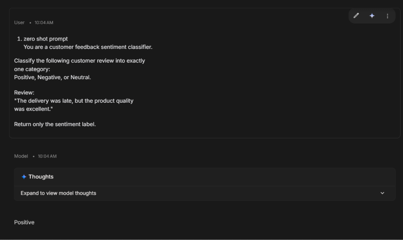
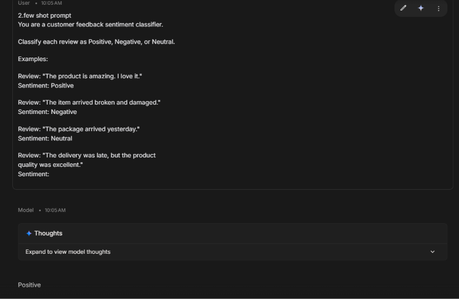
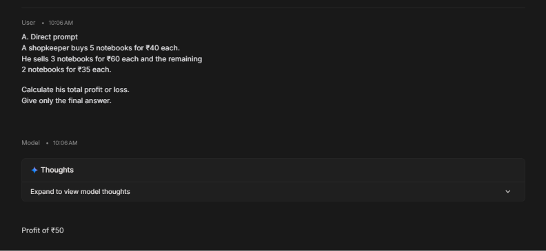
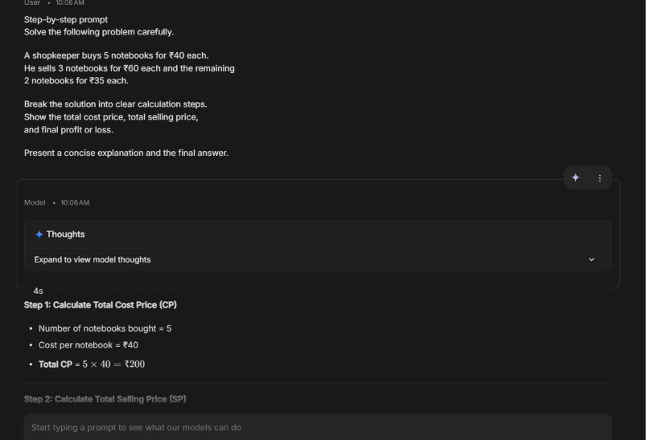
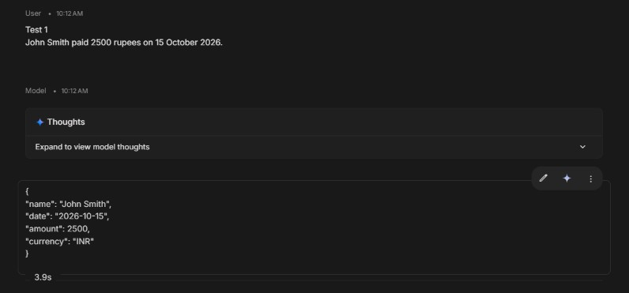
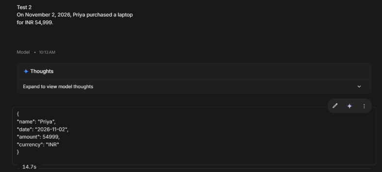
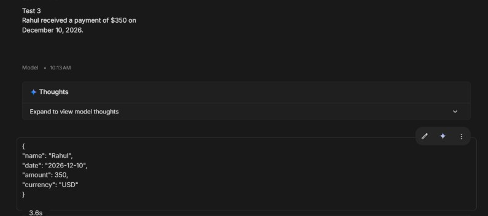
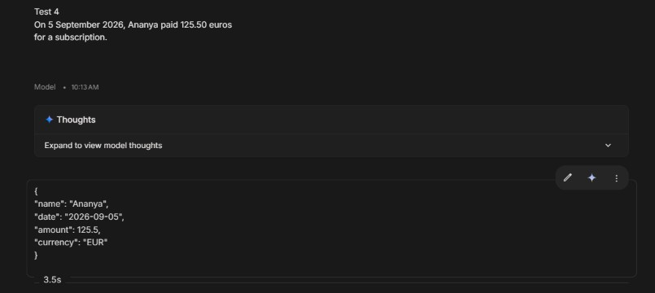
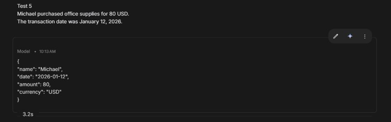

# Prompt Engineering Experiments

## Practical Study of Zero-Shot, Few-Shot, Chain-of-Thought, and Structured Output Prompting

**Internship Organization:** Valentius Kryptix  
**Project Type:** Prompt Engineering – Practical Experiments  
**AI Platform:** Google AI Studio  
**AI Model:** Gemini  
**Programming Required:** No  
**Status:** Completed

---

## 1. Introduction

Prompt Engineering is the process of designing and refining instructions given to Large Language Models (LLMs) to obtain accurate, relevant, and well-structured responses.

The objective of this project is to understand how different prompting techniques influence the quality, consistency, reasoning, and formatting of AI-generated responses.

Three practical experiments were conducted using Google AI Studio and Gemini:

1. Zero-Shot vs Few-Shot Prompting
2. Direct Prompting vs Step-by-Step (Chain-of-Thought) Prompting
3. Structured Information Extraction using JSON Output

Each experiment was performed by entering prompts into Google AI Studio, observing the model responses, and analyzing the results.

---

## 2. Objectives

- Understand the difference between zero-shot and few-shot prompting.
- Compare direct prompting with step-by-step reasoning instructions.
- Explore how prompts can guide an AI model to solve multi-step problems.
- Extract structured information from natural language.
- Generate valid JSON responses using predefined output requirements.
- Understand the importance of prompt clarity, constraints, and output formatting.

---

## 3. Tools and Technologies Used

| Tool / Technology | Purpose |
|---|---|
| Google AI Studio | Prompt execution and experimentation |
| Gemini | Large Language Model used for experiments |
| JSON | Structured information representation |
| Markdown | Documentation and report preparation |
| GitHub | Project documentation and submission |

---

# 4. Experiment 1: Zero-Shot vs Few-Shot Prompting

## 4.1 Objective

To compare zero-shot and few-shot prompting techniques using a customer feedback sentiment classification task.

The objective is to determine whether providing examples improves the model's classification response.

## 4.2 Input Review

"The delivery was late, but the product quality was excellent."

The model was instructed to classify the review into one of three categories:

- Positive
- Negative
- Neutral

## 4.3 Zero-Shot Prompting

**Prompt:**

```text
You are a customer feedback sentiment classifier.

Classify the following customer review into exactly
one category:

Positive, Negative, or Neutral.

Review:
"The delivery was late, but the product quality
was excellent."

Return only the sentiment label.
```

**Actual Model Output:**

```text
Positive
```

**Explanation:**

Zero-shot prompting provides instructions without giving the model any labeled examples. The model uses its existing language understanding to classify the review.

## 4.4 Few-Shot Prompting

**Prompt:**

```text
You are a customer feedback sentiment classifier.

Classify each review as Positive, Negative, or Neutral.

Examples:

Review: "The product is amazing. I love it."
Sentiment: Positive

Review: "The item arrived broken and damaged."
Sentiment: Negative

Review: "The package arrived yesterday."
Sentiment: Neutral

Review: "The delivery was late, but the product
quality was excellent."
Sentiment:
```

**Actual Model Output:**

```text
Positive
```

**Explanation:**

Few-shot prompting provides three labeled examples before asking the model to classify the new review. These examples demonstrate the expected classification pattern.

## 4.5 Results Comparison

| Criteria | Zero-Shot | Few-Shot |
|---|---|---|
| Examples provided | No | Yes – 3 examples |
| Task | Sentiment classification | Sentiment classification |
| Model output | Positive | Positive |
| Correct classification | Yes | Yes |

## 4.6 Observation and Analysis

Both zero-shot and few-shot prompting produced the same output: Positive.

The conjunction "but" acts as a contrast marker between the two statements. Although the delivery experience was negative, the product quality was described positively. The model appears to have given greater importance to the positive statement.

In this experiment, zero-shot prompting successfully classified the review without requiring examples. Few-shot prompting also produced the correct result by using the provided examples as guidance.

However, few-shot prompting may provide additional value when handling domain-specific terminology, ambiguous reviews, or custom output requirements.

The experiment demonstrates that providing examples does not necessarily change the model's answer when the classification task is straightforward.

**Result:** Both prompting techniques successfully classified the customer review as Positive.

---

# 5. Experiment 2: Direct Prompting vs Step-by-Step Prompting

## 5.1 Objective

To compare direct prompting and step-by-step prompting for solving a multi-step mathematical problem involving profit and loss.

The experiment evaluates whether requesting intermediate calculations makes the solution easier to understand and verify.

## 5.2 Problem Statement

A shopkeeper buys 5 notebooks for ₹40 each.

He sells 3 notebooks for ₹60 each and the remaining 2 notebooks for ₹35 each.

Calculate his total profit or loss.

## 5.3 Direct Prompting

**Prompt:**

```text
A shopkeeper buys 5 notebooks for ₹40 each.

He sells 3 notebooks for ₹60 each and the remaining
2 notebooks for ₹35 each.

Calculate his total profit or loss.

Give only the final answer.
```

**Actual Model Output:**

```text
Profit of ₹50
```

**Explanation:**

The direct prompt asks the model to solve the problem and return only the final answer without showing intermediate calculations.

## 5.4 Step-by-Step Prompting

**Prompt:**

```text
Solve the following problem carefully.

A shopkeeper buys 5 notebooks for ₹40 each.

He sells 3 notebooks for ₹60 each and the remaining
2 notebooks for ₹35 each.

Break the solution into clear calculation steps.

Show the total cost price, total selling price,
and final profit or loss.

Present a concise explanation and the final answer.
```

**Actual Model Output:**

```text
Step 1: Calculate Total Cost Price (CP)

Number of notebooks bought = 5

Cost per notebook = ₹40

Total CP = 5 × 40 = ₹200


Step 2: Calculate Total Selling Price (SP)

Sale of first 3 notebooks:
3 × 60 = ₹180

Sale of remaining 2 notebooks:
2 × 35 = ₹70

Total SP = 180 + 70 = ₹250


Step 3: Determine Profit or Loss

Since Selling Price (₹250) is greater than
Cost Price (₹200), the shopkeeper made a profit.

Profit = Total SP − Total CP

Profit = 250 − 200 = ₹50


Final Answer:

The shopkeeper made a profit of ₹50.
```

## 5.5 Mathematical Verification

**Total Cost Price:**

5 × ₹40 = ₹200

**Total Selling Price:**

(3 × ₹60) + (2 × ₹35)

= ₹180 + ₹70

= ₹250

**Profit Calculation:**

Profit = Selling Price − Cost Price

Profit = ₹250 − ₹200

Profit = ₹50

## 5.6 Results Comparison

| Criteria | Direct Prompting | Step-by-Step Prompting |
|---|---|---|
| Output style | Final answer only | Detailed calculation |
| Intermediate steps | Not provided | Provided |
| Final answer | ₹50 profit | ₹50 profit |
| Correctness | Correct | Correct |
| Verifiability | Limited | High |

## 5.7 Observation and Analysis

Both direct prompting and step-by-step prompting generated the correct answer of ₹50 profit.

Direct prompting was concise and provided the final answer immediately. It was suitable for a simple arithmetic problem where only the result was required.

Step-by-step prompting provided a detailed explanation of the cost price, selling price, and profit calculation. This made the result easier to understand and independently verify.

The experiment demonstrates that specifying the expected reasoning format can improve the transparency and usefulness of an answer. However, this single problem does not establish that step-by-step prompting always reduces errors.

**Result:** Both techniques solved the problem correctly, while step-by-step prompting provided greater calculation transparency.

---

# 6. Experiment 3: Structured Information Extraction Using JSON

## 6.1 Objective

To extract structured transaction information from natural-language sentences and generate JSON responses following a predefined schema.

The experiment evaluates:

- Information extraction accuracy.
- JSON formatting consistency.
- Date standardization.
- Numeric amount extraction.
- Currency normalization.

## 6.2 Required JSON Schema

Each response must contain the following fields:

```json
{
  "name": "string",
  "date": "YYYY-MM-DD",
  "amount": "number",
  "currency": "string"
}
```

## 6.3 Prompt Instructions

The model was instructed to follow these requirements:

```text
Extract the transaction details from the given text.

Return the result using the following JSON structure:

{
  "name": "string",
  "date": "YYYY-MM-DD",
  "amount": "number",
  "currency": "string"
}

Rules:

1. Return valid JSON only.
2. Do not include explanations or Markdown code fences.
3. Convert dates into YYYY-MM-DD format.
4. Return the amount as a numeric value.
5. Remove commas from numeric amounts.
6. Use null if a required value is missing.

Currency normalization rules:

- Rupees, INR, and ₹ must be returned as "INR".
- Dollars, USD, and $ must be returned as "USD".
- Euros, EUR, and € must be returned as "EUR".
- Always use the three-letter ISO 4217 currency code.
```

## 6.4 Test Cases and Actual Outputs

### Test 1

**Input:**

```text
John Smith paid 2500 rupees on 15 October 2026.
```

**Actual Model Output:**

```json
{
  "name": "John Smith",
  "date": "2026-10-15",
  "amount": 2500,
  "currency": "INR"
}
```

### Test 2

**Input:**

```text
On November 2, 2026, Priya purchased a laptop
for INR 54,999.
```

**Actual Model Output:**

```json
{
  "name": "Priya",
  "date": "2026-11-02",
  "amount": 54999,
  "currency": "INR"
}
```

### Test 3

**Input:**

```text
Rahul received a payment of $350 on
December 10, 2026.
```

**Actual Model Output:**

```json
{
  "name": "Rahul",
  "date": "2026-12-10",
  "amount": 350,
  "currency": "USD"
}
```

### Test 4

**Input:**

```text
On 5 September 2026, Ananya paid 125.50 euros
for a subscription.
```

**Actual Model Output:**

```json
{
  "name": "Ananya",
  "date": "2026-09-05",
  "amount": 125.5,
  "currency": "EUR"
}
```

### Test 5

**Input:**

```text
Michael purchased office supplies for 80 USD.
The transaction date was January 12, 2026.
```

**Actual Model Output:**

```json
{
  "name": "Michael",
  "date": "2026-01-12",
  "amount": 80,
  "currency": "USD"
}
```

## 6.5 Results Summary

| Test | Extracted Name | Date | Amount | Currency | Result |
|---|---|---|---:|---|---|
| 1 | John Smith | 2026-10-15 | 2500 | INR | Pass |
| 2 | Priya | 2026-11-02 | 54999 | INR | Pass |
| 3 | Rahul | 2026-12-10 | 350 | USD | Pass |
| 4 | Ananya | 2026-09-05 | 125.5 | EUR | Pass |
| 5 | Michael | 2026-01-12 | 80 | USD | Pass |

## 6.6 Success Rate Calculation

Success Rate = (Successful Outputs / Total Test Cases) × 100

Success Rate = (5 / 5) × 100

**Success Rate = 100%**

All five final outputs matched the required field values, date format, numeric amount format, and normalized currency codes.

## 6.7 Observation and Analysis

The experiment demonstrated that clear formatting instructions and normalization rules can guide an LLM to generate consistent structured responses.

The model successfully:

- Extracted names from natural-language sentences.
- Converted different date representations into YYYY-MM-DD format.
- Extracted numeric amounts without unnecessary commas.
- Converted currency symbols and descriptions into standardized three-letter currency codes.
- Returned JSON without conversational explanations or Markdown formatting in the actual model responses.

An important part of this experiment was refining the currency normalization instructions. Explicitly specifying the required ISO currency codes helped produce consistent outputs such as INR, USD, and EUR.

**Result:** All five final test cases successfully met the specified structured output requirements, achieving a 100% success rate.

---

# 7. Overall Comparison of Experiments

| Experiment | Technique | Main Observation |
|---|---|---|
| Experiment 1 | Zero-Shot vs Few-Shot | Both produced the same correct sentiment classification. |
| Experiment 2 | Direct vs Step-by-Step | Both solved the calculation correctly; step-by-step provided more transparency. |
| Experiment 3 | Structured JSON Output | All five final test cases met the required output format and extraction rules. |

---

# 8. Key Learnings

Through these experiments, the following concepts were understood:

1. **Zero-Shot Prompting:** A model can perform a task using clear instructions without requiring examples.

2. **Few-Shot Prompting:** Providing examples helps demonstrate the expected task and response pattern.

3. **Direct Prompting:** Simple instructions can generate concise answers for straightforward tasks.

4. **Step-by-Step Prompting:** Requesting intermediate calculations makes mathematical results easier to verify.

5. **Structured Output Prompting:** Defining an output schema helps generate consistent JSON responses.

6. **Prompt Refinement:** Adding explicit rules for date formats, numeric values, and currency codes improves output consistency.

7. **Output Validation:** Model responses should be checked against the expected values and formatting requirements instead of assuming that every generated response is correct.

---

# 9. Conclusion

This project provided practical experience with different Prompt Engineering techniques using Google AI Studio and Gemini.

The first experiment demonstrated how zero-shot and few-shot prompting can classify customer feedback. The second experiment compared direct and step-by-step prompting for a mathematical profit calculation. The third experiment demonstrated structured information extraction by converting natural-language transaction descriptions into standardized JSON responses.

The experiments highlighted the importance of clear instructions, examples, output constraints, and prompt refinement when interacting with Large Language Models.

Overall, this project improved my understanding of how to design effective prompts, evaluate AI-generated responses, and obtain structured outputs for practical applications.

---

# 10. Screenshots and Evidence

The following screenshots demonstrate the prompts and actual model responses obtained during the experiments in Google AI Studio.

### Experiment 1 – Zero-Shot and Few-Shot Prompting

**Zero-Shot Prompt and Output**



**Few-Shot Prompt and Output**



### Experiment 2 – Direct and Step-by-Step Prompting

**Direct Prompt and Output**



**Step-by-Step Prompt and Output**



### Experiment 3 – Structured JSON Output

**Test 1**



**Test 2**



**Test 3**



**Test 4**



**Test 5**



---

# 11. Project Information

**Project:** Prompt Engineering Experiments  
**Organization:** Valentius Kryptix  
**Platform:** Google AI Studio  
**Model:** Gemini  
**Documentation:** GitHub Markdown

---

*This project was completed as part of the Prompt Engineering internship task at Valentius Kryptix.*
